## 🚀 Projetos

<table>
<tr>
<td width="50%" valign="top">

**📊 Painel Financeiro (demo)** 
Contas a pagar e receber, com cards de resumo, gráfico de 12 meses, busca por código e tema claro/escuro.

</td>
<td width="50%" valign="top">

**📱 Consulta de Produtos (demo)** 
App Android com catálogo web em tela cheia, busca por código, EAN, nome ou lote e ficha em PDF. A versão real é privada.

</td>
</tr>
</table>

Os dois projetos acima são demos com dados fictícios.

## 🧩 O que eu faço

<table>
<tr>
<td width="33%" valign="top">

**📱 Apps Android (Java)** 
Aplicativos que ajudam a equipe de vendas no dia a dia, com build e distribuição automatizados.

</td>
<td width="33%" valign="top">

**⚙️ Automação** 
Rotinas manuais viram processos com Google Apps Script e GitHub Actions.

</td>
<td width="33%" valign="top">

**🛠️ Suporte e sistemas de TI** 
Apoio direto às operações de vendas: equipamentos, acessos e sistemas.

</td>
</tr>
</table>

<b>🧭 Como eu trabalho</b>

 

- Começo pelo **problema**, não pela tecnologia.
- Uso **IA como copiloto** para construir rápido e **valido** regra, número e resultado antes de entregar.
- Prefiro ferramenta **simples** que as pessoas abrem sozinhas a algo complexo que ninguém usa.

<b>📱 Minha experiência com apps</b>

 

- Desenvolvo **aplicativos Android em Java**, com build via **Gradle**.
- Já entreguei app que abre um **catálogo web em tela cheia** e gera **PDF da ficha** do produto.
- Automatizo o **build e a distribuição do APK** para a equipe usando **GitHub Actions**.
- Crio **automações com Google Apps Script** para tirar tarefa manual do caminho.
- Desenvolvo olhando para o **uso real** do time de vendas, no celular, no campo.

<b>🚧 Em andamento</b>

 

- Painel de **contas a pagar e receber** para o financeiro (demo pública com dados fictícios)
- Novos apps e automações para o time de vendas
- Evolução em desenvolvimento de software

## 🧰 Stack

## 📊 No GitHub

## 📫 Contato

